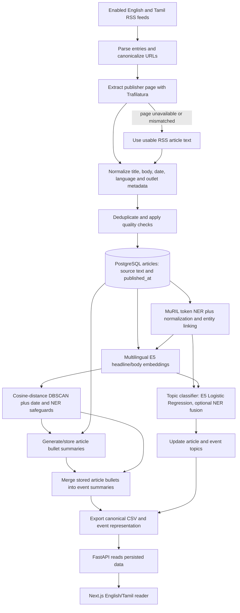

# Veritasium project prerequisites and implementation guide

This guide is for someone new to the repository. It explains what the project
does, why each model is used, how model training is prepared, and how article
features move from RSS feeds into the application.

## 1. What the project does

Veritasium collects English and Tamil news from configured RSS feeds, extracts
the publisher article text, cleans and stores each article, and enriches it
with named entities, a semantic vector, an editorial topic, and a source-based
bullet summary. Related articles are grouped into events. The API serves those
stored results to the web application.

PostgreSQL is the authoritative store. The main CSV,
`src/backend/data/trafiltura_preprocessed.csv`, is a current export of the
database and is useful for annotation, inspection, and sharing analysis
results. It is not the live database or an independent model store.

## 2. Workflow diagram



The usual step order is RSS fetch and clean → NER → embeddings and event
clustering → topic assignment → summary persistence → exports. The complete
runner is `scripts/run_pipeline.sh`.

## 3. Before running the project

### Required local services and software

- Python 3.10 (the project environment has been used with Python 3.10).
- Node.js and npm compatible with the installed Next.js 16 frontend.
- PostgreSQL with the `vector` extension available. The application uses
  SQLAlchemy and `pgvector` for 768-dimensional embeddings.
- A Python virtual environment with packages from `requirements.txt`.
- Internet access the first time a Hugging Face model is downloaded, unless
  the model is already cached locally.
- CUDA-enabled PyTorch and a compatible NVIDIA driver if models should use the
  GPU. Most model stages can use CPU, but full reprocessing will take longer.
- PyTorch 2.6 or newer is required for the Transformers checkpoint-loading
  path used by the summarizer. Check `torch.cuda.is_available()` in the active
  virtual environment before expecting CUDA acceleration.

### Initial setup

From the project root:

```bash
python3 -m venv venv
source venv/bin/activate
pip install -r requirements.txt
cp .env.example .env
```

Edit `.env` with the PostgreSQL connection details for your machine. Do not
commit real passwords or API secrets. Ensure PostgreSQL is running before
fetching feeds, running model jobs, or starting the API.

Start the live app in two terminals:

```bash
./scripts/start_backend.sh
```

```bash
./scripts/start_frontend.sh
```

For an ordinary feed and model refresh, run:

```bash
./scripts/run_pipeline.sh
```

To refresh existing database articles as well as new feed items:

```bash
./scripts/run_pipeline.sh --refresh-existing
```

The latter reruns NER, embeddings, topics, summaries, clustering, and exports
for the existing article corpus. It can take a while and needs disk space,
RAM, and—when enabled—GPU memory.

## 4. Ingestion, normalization, and storage

### RSS source configuration

RSS definitions are maintained in:

- `src/backend/config/sources.yaml` — primary source configuration.
- `src/backend/ingestion/config/sources.yaml` — ingestion-side copy used by
  the Celery ingestion path.

Each source entry identifies its slug, display name, language, homepage, RSS
URLs, enabled status, fetch interval, request limit, and broad source category.
The active sources include both English and Tamil publishers. An entry with
`enabled: false` is deliberately skipped.

The standalone fetcher is `src/backend/scripts/fetch_rss_standalone.py`; the
Celery task is `src/backend/ingestion/tasks/fetch_feed.py`. Both use shared
helpers from `src/backend/ingestion/tasks/text_cleaning.py`.

### What cleaning does

- Converts HTML to readable text and normalizes whitespace and Unicode.
- Checks publisher-page headlines against the RSS headline before trusting
  extracted page text; mismatched or unusable pages fall back to RSS content.
- Removes repeated title text, navigation, outlet/editor boilerplate, and
  known source-specific metadata such as Livemint staff bylines.
- Normalizes canonical URLs and publication timestamps. Aware timestamps are
  stored as Asia/Kolkata wall time in the timezone-naive `published_at`
  database column.
- Detects English or Tamil, extracts useful dateline/location information,
  and rejects empty or low-quality article bodies.
- Deduplicates using stable feed identity, URL, and content fields before
  inserting a row.

Raw extracted content and normalized `clean_text` are both retained. This
allows debugging the cleaner without treating untrusted publisher markup as
model input.

### Database and export fields

The core schema is declared in `src/backend/models/database.py`. An article
stores its publisher identity and URL, title, source language, `published_at`,
raw and clean text, topic metadata, JSON `named_entities`, JSON `summary`, a
768-value `embedding`, the model identifier, and a direct `cluster_id`. Event
rows live in `news_clusters` and store representative title, topic, centroid
vector, and English/Tamil summary bullets.

`src/backend/export/csv_export.py` rebuilds the canonical processed CSV from
PostgreSQL after processing. Embeddings, entities, topics, summaries, and
cluster IDs are serialized as JSON or scalar columns. `raw_processed.csv` is
an ingestion/staging export. The CSV `published_at` value comes from the same
database field used by the reader's date filter.

## 5. Named-entity recognition (NER)

### Why it is used

NER identifies people, organizations, locations, events, and dates. Those
entities help readers understand an event and help the event-clustering and
topic-classification stages distinguish stories. Entity aliases can be
normalized across publishers and English/Tamil spelling variants.

### Model architecture

The training architecture is `google/muril-base-cased`, a multilingual BERT
encoder, with a token-classification head. For every input token, the model
predicts a BIO tag:

- `O`: token is outside a target entity.
- `B-TYPE`: token begins a PERSON, ORGANIZATION, LOCATION, EVENT, or DATE span.
- `I-TYPE`: token continues that span.

There are 11 output labels: `O`, plus a begin and inside label for each of the
five entity types. Word-level labels are aligned to MuRIL WordPieces. The
trainer handles slow and fast tokenizers separately; special tokens and
padding are ignored in loss computation. A weighted token loss gives EVENT
labels additional influence because event spans are comparatively rare.

The model is open-vocabulary: the transformer can predict unseen names.
Bilingual gazetteers and Tamil morphology/alias normalization add recall and
canonicalization; they do not restrict predictions to a fixed list.

### Training data and training process

The preparation tools use cleaned English/Tamil articles derived from the
canonical CSV. The annotation process combines a multilingual teacher and
gazetteer/context rules to make weak BIO labels. These labels make it possible
to bootstrap training, but they are not human-verified truth. Review
annotations—especially Tamil spans and EVENT entities—before relying on
evaluation scores or deploying a new checkpoint.

Training proceeds as follows:

1. `prepare_data.py` extracts valid cleaned articles and builds separate
   English/Tamil corpora.
2. `auto_annotate.py` creates weak BIO examples and the train/validation JSONL
   files; inspect and correct the generated labels where possible.
3. `train.py` fine-tunes MuRIL for token classification and checks that both
   languages have EVENT spans in train and validation data.
4. Evaluation computes exact-span precision, recall, and F1 by entity class,
   as well as macro/micro metrics and secondary token accuracy. It writes
   consolidated CSV metrics and training history under the NER data folder.
5. Runtime inference prefers the configured local fine-tuned checkpoint. If
   unavailable and permitted, Babelscape multilingual NER is the teacher
   fallback. Results are normalized and saved into article rows.

Commands:

```bash
./scripts/prepare_ner_data.sh
./scripts/train_ner.sh
./scripts/evaluate_ner.sh
```

Run only after there are reviewed or at least inspected annotations. NER
training is not part of a normal daily pipeline run.

## 6. Multilingual embeddings and event clustering

### Semantic embeddings

`intfloat/multilingual-e5-base` is used because it produces a shared semantic
space for English and Tamil. The model returns a 768-dimensional vector. The
input is split into a headline and body: headline signal is weighted more
heavily, while long bodies are broken into bounded chunks and averaged. The
result is normalized and stored in PostgreSQL with its model name and creation
time. A changed normalized article or model name triggers re-embedding.

### Event clustering

`src/backend/semantic_processing/clustering_service.py` runs DBSCAN over a
precomputed cosine-distance matrix. E5 similarity is the primary evidence;
NER agreement is only a bounded corroboration, so a shared person or place
cannot by itself create an event. The clustering allows cross-language
comparisons in the multilingual embedding space.

DBSCAN can form a chain through a middle article even when the endpoints are
unrelated. A complete-link refinement splits those chains unless every pair
inside the accepted group remains within the cosine-distance threshold and
the publication-date window. Noise articles remain standalone. Reused event
IDs are matched against previous event centroids to reduce ID churn between
pipeline runs.

## 7. Topic classification

### Why it is used

The topic label groups events into useful editorial sections. The taxonomy is
defined in `src/backend/config/topic_taxonomy.yaml` and includes bilingual
labels, descriptions, and keywords. Outliers and low-confidence results map to
`other_current_affairs` (“Other”). An event inherits the majority topic among
its member articles; a tie maps to Other.

### Model architecture and selection

The main supervised classifier is `intfloat/multilingual-e5-base` followed by
Logistic Regression. The embedding provides dense semantic features and the
classifier maps them to the project taxonomy. A second candidate appends
typed NER features (PERSON, ORGANIZATION, LOCATION, and EVENT) transformed to
sparse weighted features. The comparison selects E5+NER only when its
stratified cross-validation macro F1 exceeds E5-only by the configured minimum
gain. The held-out split is used for reporting, not model selection.

`google/muril-base-cased` is also implemented as an A/B fine-tuned sequence
classifier. It is an experiment rather than an assumption that it performs
better: the output layer is newly initialized for the topic taxonomy and must
be trained on reviewed bilingual labels. Runtime fallback order is selected
supervised model → multilingual zero-shot classifier → bilingual keyword
rules. Ambiguous or low-confidence supervised outputs become Other.

Prepare and annotate examples before training:

```bash
./scripts/prepare_topic_labels.sh \
  --input src/backend/data/trafiltura_preprocessed.csv \
  --output src/backend/data/topic_labels_500_to_annotate.csv \
  --per-language 250
```

Review `suggested_topic` and write the final class into the `topic` column.
Then train and compare the E5 and NER-fusion candidates:

```bash
./scripts/train_topic_classifier.sh src/backend/data/topic_labels_500_to_annotate.csv
```

Metrics, `selected.json`, and model artifacts are written below
`src/backend/models/topic_classifier/`. Suggested labels are weak labels until
human-reviewed.

## 8. Bullet summarization

### Why it is used

Each publisher article should have a concise, source-grounded set of bullet
points. Saving article summaries once avoids model inference whenever an
event page is opened. Event summaries merge the stored bullets from member
articles separately for English and Tamil.

### Model architecture

The base is `csebuetnlp/mT5_multilingual_XLSum`, an encoder-decoder text-to-text
model trained for multilingual summarization. If the local fine-tuned LoRA
adapter is available and preferred, it is used with the base checkpoint.
Otherwise the multilingual base model runs directly. Fine-tuning applies LoRA
to the attention `q` and `v` projections, leaving most base parameters frozen.

Training examples contain language, headline, article body, and reviewed
bullet targets. Examples sharing an event group stay in the same split to
reduce train/validation leakage. Both languages need at least 20 reviewed
article-summary pairs. Training uses one example per device step, gradient
accumulation, gradient checkpointing, and fp16 when CUDA is available. At
inference time, long bodies are chunked with overlap; generated points are
checked for language and source grounding. If model loading, output language,
or grounding fails, the pipeline uses extracted source sentences rather than
inventing a summary.

Prepare reviewed examples, fill the bullet targets, and train:

```bash
./scripts/prepare_summary_labels.sh --per-language 250
./scripts/train_summarizer.sh src/backend/data/summary_labels_to_annotate.csv --epochs 3
```

Regular runs persist missing/stale summaries. To force regeneration, use:

```bash
./scripts/generate_summaries.sh --force
```

## 9. Feature reference

- **RSS acquisition:** Reads enabled bilingual feeds, extracts full articles
  where possible, and keeps RSS as a fallback.
- **Normalization and quality control:** Produces one clean title/body,
  removes source boilerplate, checks language and usable body length, and
  avoids storing mismatched page content as a different article.
- **Publication timestamp:** Stores the publisher/feed publication time as
  `Article.published_at`; the date control uses this field rather than fetch or
  insertion time.
- **NER:** Stores open-vocabulary PERSON, ORGANIZATION, LOCATION, EVENT, DATE
  spans plus linked/normalized forms.
- **Embeddings:** Stores normalized multilingual 768-dimensional E5 vectors
  for semantic search, clustering, and topic classification.
- **Event clustering:** Uses cosine distance, DBSCAN, publication-time guards,
  bounded NER overlap, and complete-link refinement.
- **Topic assignment:** Writes topic, confidence, and classifier identity at
  article level, then assigns a majority topic at event level.
- **Article summarization:** Saves generated/extractive source-language
  bullets and hashes in PostgreSQL so unchanged articles are not repeatedly
  summarized.
- **Event summarization:** De-duplicates and merges article bullets by
  language and stores the result on the event.
- **Search and date filtering:** Searches event and article headlines and
  filters coverage by article `published_at` dates, while retaining the
  selected topic. Combining these filters narrows results together.
- **Serving and exports:** FastAPI reads stored enrichment; Next.js presents
  the English/Tamil experience; CSV exports mirror processed database state.

## 10. Configuration reference

The actual local `.env` overrides defaults. Keep secrets out of this guide and
out of version control. The tracked example is `.env.example`; additional
defaults are defined beside each model.

| Setting | Default / location | Purpose |
| --- | --- | --- |
| `EMBEDDING_MODEL_NAME` | `intfloat/multilingual-e5-base` | Shared English/Tamil vector model. |
| `EMBEDDING_DEVICE` | `cuda` in `.env.example`; code supports `auto`, `cpu`, `cuda` | Embedding inference device. CUDA OOM can retry the batch on CPU. |
| `EMBEDDING_BATCH_SIZE` | `32` | Number of article vectors processed per batch. |
| `EMBEDDING_MAX_CHUNK_CHARS` | `1800` | Maximum body chunk size before long article text is split for encoding. |
| `HEADLINE_VECTOR_WEIGHT` | `0.65` | Weight given to headline relative to the body vector. |
| `DBSCAN_EPS` | `0.20` | Maximum cosine-distance neighborhood radius. |
| `DBSCAN_MIN_SAMPLES` | `2` | DBSCAN density requirement. |
| `CLUSTER_MAX_GAP_DAYS` | `5` | Maximum publication-time gap within event clusters. |
| `CLUSTER_MAX_ARTICLES` | `50` | Maximum accepted cluster size during refinement. |
| `CLUSTER_ID_REUSE_SIMILARITY` | `0.90` | Minimum centroid similarity for reusing an event ID. |
| `NER_PREFER_FINETUNED_MODEL` | `1` | Prefer the local MuRIL NER checkpoint when available. |
| `NER_ALLOW_TEACHER_FALLBACK` | `1` | Allow Babelscape fallback if the fine-tuned NER model cannot load. |
| NER sequence/training values | `config.py`: length 192, train/eval batch 1, accumulation 8, LR `3e-5`, 10 epochs, weight decay `0.01`, warmup `0.1`, fp16 enabled | Keep token-classifier training within local GPU memory. |
| NER training safeguards | Grouped train/validation split 85/15, Adafactor, gradient checkpointing, early-stopping patience 3 | Reduce event leakage and limit GPU memory and wasted epochs. |
| `NER_EVENT_LOSS_WEIGHT` | `2.5` | Additional loss weight for B/I-EVENT tags. |
| `NER_MIN_CONFIDENCE` | `0.35` | Minimum entity confidence used by downstream entity features. |
| `NER_BATCH_SIZE` / `NER_MAX_SENTENCES` | `16` / `0` | Inference batch size; zero means process the whole article rather than truncating to a sentence count. |
| `TOPIC_CLASSIFIER_BACKEND` | `auto` | Load selected supervised topic model or fallbacks. |
| `TOPIC_DEVICE` | `auto` | Device used for topic training/embedding. |
| `TOPIC_ZERO_SHOT_MODEL` | `MoritzLaurer/multilingual-MiniLMv2-L6-mnli-xnli` | Multilingual fallback topic classifier. |
| `TOPIC_ZERO_SHOT_MIN_SCORE` / `TOPIC_ZERO_SHOT_MIN_MARGIN` | `0.45` / `0.05` | Confidence and separation thresholds for zero-shot output. |
| `TOPIC_NER_MIN_CV_GAIN` | `0.01` | Required macro-F1 improvement before selecting E5+NER fusion. |
| `TOPIC_MAX_LENGTH` | `256` | MuRIL topic classifier input length. |
| MuRIL topic experiment | Batch 2, gradient accumulation 4, learning rate `2e-5`, 3 default epochs | Fine-tunes the comparative MuRIL topic-classification candidate. |
| `TOPIC_MIN_FREE_DISK_GB` | `1.5` | Skip MuRIL model saving when free space is below this threshold. |
| Topic model currently selected | `src/backend/models/topic_classifier/selected.json` | Records the candidate selected by the latest comparison; selection can change after retraining. |
| `SUMMARY_BASE_MODEL` | `csebuetnlp/mT5_multilingual_XLSum` | Bilingual encoder-decoder summarization checkpoint. |
| `SUMMARY_FINETUNED_MODEL_PATH` | `src/backend/models/summarizer/best` | Local LoRA fine-tuned model/adapter directory. |
| `SUMMARY_PREFER_FINETUNED` | `1` | Prefer a local fine-tuned adapter when present. |
| `SUMMARY_DEVICE` | `cuda` in `.env.example`; code supports `auto`, `cpu`, `cuda` | Summary generation device; CUDA model load/OOM can retry on CPU. |
| Summary inference constants | Input 512 tokens, chunks 448 with overlap 48, max 84 new tokens, max 7 bullets | Bound generation cost and keep article summaries compact. |
| Summary training constants | Source 448 tokens, target 192, LoRA rank 8/alpha 16/dropout 0.05, accumulation 8, LR `2e-4`, 3 default epochs | Fine-tune with reviewed target bullets under limited GPU memory. |
| `BREAKING_NEWS_WINDOW_HOURS` | `24` | Recency window used by breaking-news event selection. |
| Feed interval | Per-feed `fetch_interval_minutes: 15` in YAML | Publisher polling schedule used by feed configuration. |

`CLUSTER_MIN_CENTROID_SIMILARITY` and `CLUSTER_MIN_PAIRWISE_SIMILARITY` appear
as legacy/tuning settings in the clustering module, but the current DBSCAN
acceptance path is controlled by `DBSCAN_EPS`, the date constraints, and the
complete-link check.

## 11. Important paths

| Area | Path |
| --- | --- |
| Feed list | `src/backend/config/sources.yaml` |
| Text cleaner | `src/backend/ingestion/tasks/text_cleaning.py` |
| Database schema and migrations | `src/backend/models/database.py` |
| NER training config and code | `src/backend/ner_pipeline/finetune/` |
| Runtime NER and entity linker | `src/backend/ner_pipeline/zero_shot/` |
| Embeddings and clustering | `src/backend/semantic_processing/` |
| Topic taxonomy and classifier | `src/backend/config/topic_taxonomy.yaml`, `src/backend/semantic_processing/topic_classifier.py` |
| Summary inference, training, persistence | `src/backend/summarization/` |
| Canonical CSV exporter | `src/backend/export/csv_export.py` |
| API | `src/backend/api.py` |
| Web application | `src/frontend/src/` |
| Daily/full pipeline entry point | `scripts/run_pipeline.sh` |

## 12. How to interpret model results

- Weak labels are useful for bootstrapping but are not a reliable gold test
  set. Review a separate sample of English and Tamil predictions manually.
- NER exact-span F1 is more informative than token accuracy for entity spans.
  Per-language and per-entity support counts matter; zero support means that
  class was not actually evaluated in that split.
- Topic metrics can look inflated when suggested labels are used unchanged.
  Correct labels and maintain held-out examples from both languages.
- Summary quality should be checked for factual grounding, correct language,
  coverage of distinct source details, and duplicate points.
- Event-clustering quality needs manually labelled same-event/different-event
  article pairs. Embedding similarity and DBSCAN parameters are not a substitute
  for a reviewed clustering evaluation set.

The current code writes model outputs and provenance to PostgreSQL and exports
the result. Running training changes a model artifact; use the full refresh
runner afterward if you need to recompute stored article features using that
new artifact.
